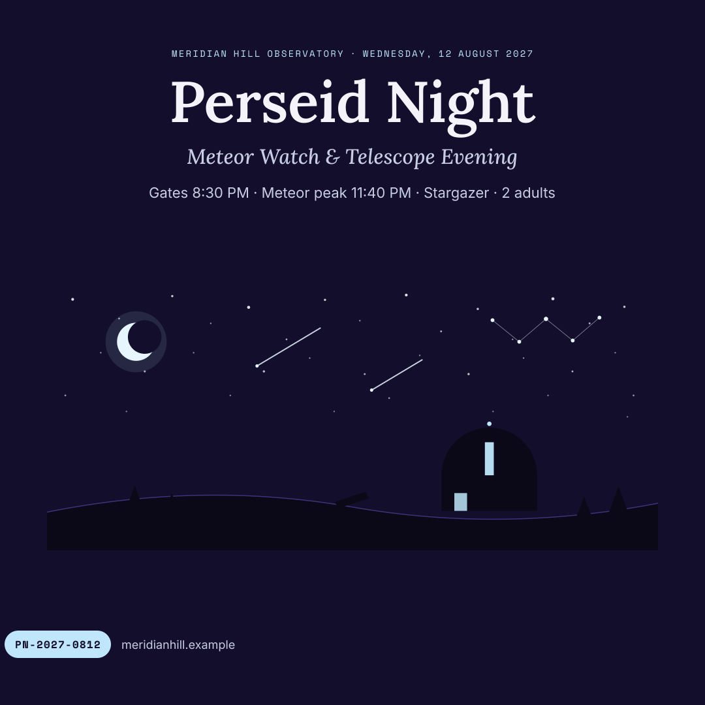
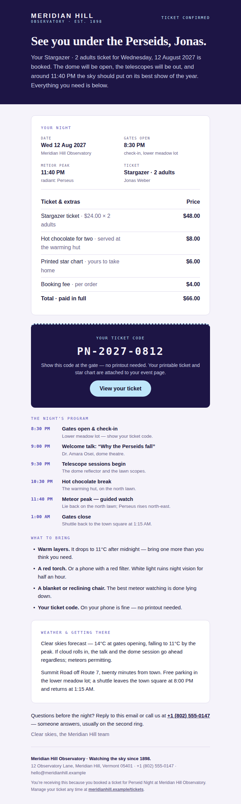
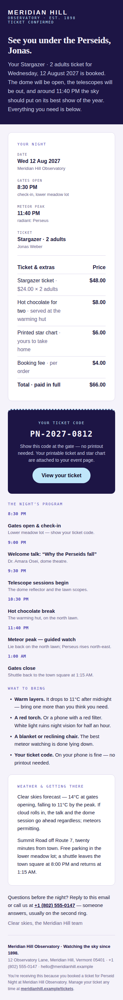
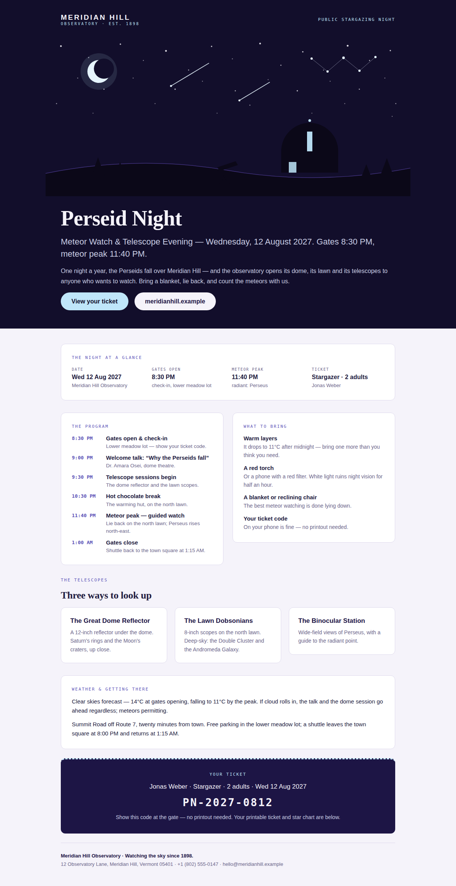
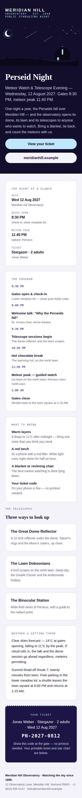
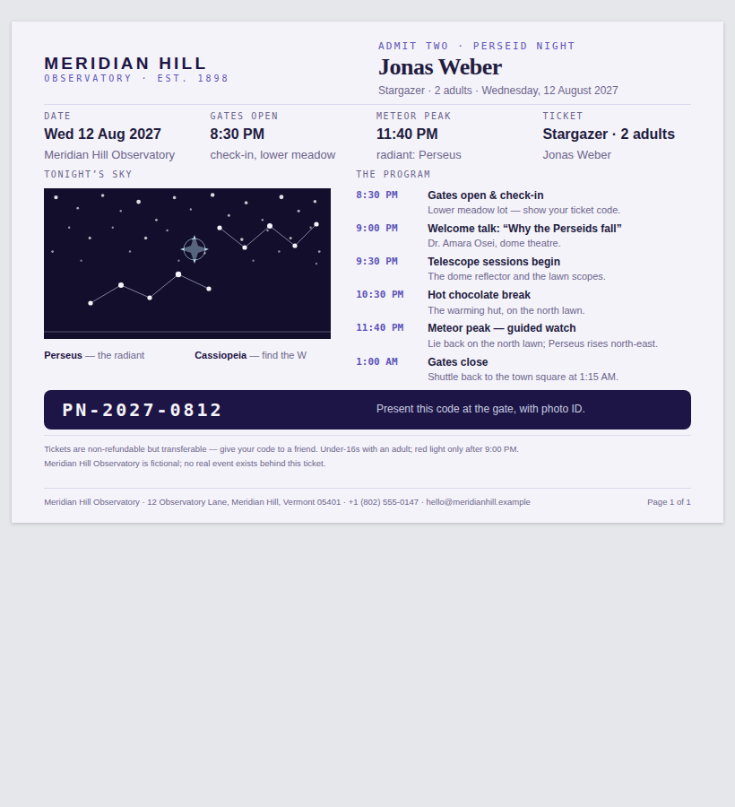

# Perseid Night — a public stargazing night kit

One fictional observatory, one event, one ticket, four outputs — all from a
single data file, a single theme, and a set of shared components, written
with [Hyper Elements](https://github.com/hyper-elements/hyper-elements)
(`@hyper-elements/react`).

Meridian Hill Observatory opens its dome, its lawn and its telescopes one
night a year, when the Perseids fall. This kit is everything a guest gets
after booking a ticket: the confirmation email, the event page, a printable
ticket with a star chart, and a share card for the night. Every visual is
drawn in code — stars, constellations, a crescent moon, the observatory
dome — there are no image assets anywhere in the project.



## The four outputs

### 1. Ticket confirmation email (600px)



The booking in one glance, the price lines, a dark ticket-style card with
the ticket code, the night's program, what to bring, and the weather note.
`render()` also produces its plain-text twin (`out/email.txt`), and the
build writes per-client previews showing the email as classic Outlook,
Gmail and Apple Mail draw it (`out/clients/`). It stacks cleanly on
phones:



### 2. Event page (960px)



The page a guest opens from the email: a night-sky hero with the
observatory drawn as Svg shapes, the night at a glance, the program, what
to bring, the telescope lineup, directions, and the ticket card. On phones
the hero shows a cropped view of the same scene:



### 3. Printable ticket + star chart — A5 landscape, HTML + PDF



One page, meant to be printed or shown on a phone at the gate: the guest,
the night, a drawn star chart of Perseus and Cassiopeia with the Perseid
radiant marked, the program, the ticket code, and the fine print. The PDF
(`out/ticket.pdf`) is exactly one page.

### 4. Social poster (1080 × 1080)


Composed like a poster — serif headline, date, ticket-code pill, the
night-sky scene — and rendered by `renderImage()` to PNG and SVG.

## How Hyper Elements was used

- **One theme, four roots.** `src/theme.ts` defines the brand once with
  `defineTheme()`: a deep indigo-violet night sky with silver and pale
  icy-blue accents, Lora for display type, Inter for body, Space Mono for
  ticket codes and labels. The same theme is handed to the `Email`,
  `Page`, `Document` and `Canvas` roots, so all four outputs are on brand
  by construction. Named styles (`card`, `darkCard`, `eyebrow`,
  `metaLabel`, `pill`) are applied with `style={{ apply: [...] }}`, the
  type scale is set per heading level, and the Button gets `ice` / `light`
  variants. A `formats.email` override tightens the headings for the
  inbox.
- **Shared components.** `src/components.tsx` holds blocks reused across
  roots: `Wordmark`, `TicketFacts`, `ProgramSchedule`, `TelescopeCard`,
  `FooterNote`, and the drawn sky — `StarField` (34 deterministic stars,
  no randomness, so every build is identical), `MoonMark`, `Meteor`,
  `NightSkyScene` (the observatory at night: stars, Cassiopeia's W, two
  meteors, a crescent moon, the dome with its lit slit, a hill, pines and
  a small telescope on the lawn), and `StarChart` (Perseus and Cassiopeia
  with the radiant marked). The email can't use Svg, so its shared blocks
  are text-only and it leans on the theme's colors and the ticket card
  instead.
- **One data model.** `src/data.ts` is the single source of truth: guest,
  event, program, price lines, ticket code, what to bring, weather. Money
  is integer cents with one formatter; dates are fixed strings, so every
  build renders identical output.
- **All four roots, all four writers.** `render()` writes the email HTML +
  plain text, the page HTML and the ticket's print HTML; `renderPdf()`
  (`@hyper-elements/react/pdf`) writes the ticket PDF; `renderImage()`
  (`@hyper-elements/react/image`) writes the poster as PNG and SVG. The
  PDF and the image get their fonts as local WOFF files from the
  `@fontsource` packages — nothing is fetched at build time.
- **Validation as a build gate.** `scripts/build.tsx` runs `validate()` on
  all four templates and fails on any error. The email is additionally
  checked with the `@hyper-elements/email-clients` plugin, and
  `renderInEmailClients()` writes a preview per client. The current build
  is clean: **0 errors, 0 warnings** on every template and render. (The
  plugin still reports info-level notes — e.g. classic Outlook draws
  square corners and no letter-spacing, and most clients don't load the
  web fonts — which are graceful degradations, not defects. The Outlook
  preview is captured in `docs/screenshots/email-outlook.png`.)

## Run it

```bash
npm install
npm run build        # validate + render everything into out/
npm run screenshots  # Playwright captures of each output, into docs/screenshots/
npm run typecheck    # tsc --noEmit
```

Requires Node 20+. Outputs land in `out/`:

| File | What it is |
| --- | --- |
| `out/email.html`, `out/email.txt` | Ticket confirmation email + plain-text twin |
| `out/page.html` | Event page |
| `out/ticket.html`, `out/ticket.pdf` | Printable ticket + star chart, print HTML + PDF (1 page) |
| `out/share-card.png`, `out/share-card.svg` | Social poster, 1080 × 1080 |
| `out/clients/*.html` | The email as Outlook, Gmail and Apple Mail draw it |

## Make it yours

Change the night in `src/data.ts` — guest, event, date, program, price
lines, ticket code — and rebuild. The email, page, ticket (including its
star chart labels) and poster all follow. Recolor the kit by editing
`palette` in `src/theme.ts`; the drawn night sky and the star chart use
the same palette, so they follow too.

## Project structure

```
src/
  data.ts        the night: guest, event, program, prices, code (edit this)
  theme.ts       defineTheme(): colors, fonts, type scale, named styles
  fonts.ts       local WOFF font files for the PDF and image engines
  components.tsx shared blocks: Wordmark, StarField, MoonMark, Meteor,
                 NightSkyScene, StarChart, TicketFacts, ProgramSchedule,
                 TelescopeCard, FooterNote
  email.tsx      ticket confirmation email (Email, 600px)
  page.tsx       event page (Page, 960px)
  document.tsx   printable ticket + star chart (Document, A5 landscape)
  canvas.tsx     social poster (Canvas, 1080 x 1080)
scripts/
  build.tsx      validate gate + all renders + email-client previews
  screenshot.ts  Playwright captures for visual checks
docs/screenshots/ captures of the rendered outputs (+ the poster PNG)
docs/share-card.svg  the poster as SVG, for the README (copied by the build)
out/             build outputs (gitignored)
```

## Fonts

Lora (display serif), Inter (body) and Space Mono (codes and labels),
all under the SIL Open Font License. No font files are committed: the
families come from the `@fontsource` npm packages, and `src/fonts.ts`
hands their WOFF files to the PDF and image engines, so the build works
offline once installed. The HTML roots load the same families as static
per-weight latin woff2 webfonts (listed in `webFonts` in `src/theme.ts`).

## Notes

- Meridian Hill Observatory is fictional, and so are the guest, the event
  and the ticket — the ticket says so in its fine print. The `.example`
  domain is reserved for exactly this.
- The star chart is a guide, not an ephemeris: the Perseus chain and
  Cassiopeia's W are drawn in their real relative shapes, but the
  positions are illustrative.
- The HTML outputs reference Google Fonts web fonts; the PDF and poster
  use the same families from local files, so the build works offline once
  installed.

## License

MIT — see [LICENSE](LICENSE). Fonts are under the SIL Open Font License.
